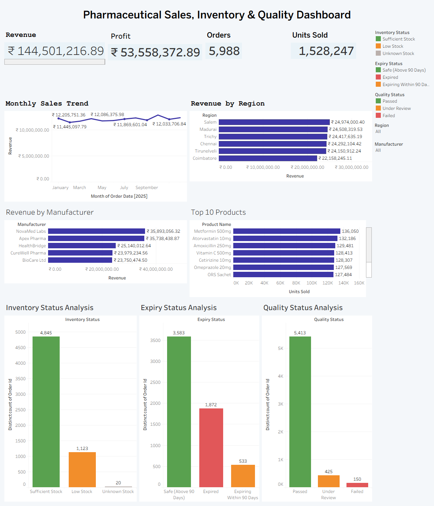

# Arunmani | Aspiring Data Analyst

## About Me
I am a B.Sc. Biotechnology graduate (2025) transitioning into Data Analytics. I am interested in using data to solve business problems and generate meaningful insights.

I have developed practical skills in Python, SQL, Excel, and Tableau through hands-on projects, including a Pharmaceutical Sales, Inventory & Quality Analytics project.

## Technical Skills
- **Programming:** Python
- **Libraries:** Pandas
- **Database:** MySQL
- **Spreadsheet:** Microsoft Excel
- **Data Visualization:** Tableau
- **Core Skills:** Data Cleaning, Data Analysis, Data Visualization, Exploratory Data Analysis (EDA)

## Projects

### Pharmaceutical Sales, Inventory & Quality Analytics Dashboard

**Tools:** Python, Pandas, MySQL, Excel, Tableau

**Project Overview:**

Analysed pharmaceutical sales, inventory, expiry, and product quality data to identify business trends and generate actionable insights.

**Key Highlights:**
- Analysed 5,988 pharmaceutical records.
- Calculated Revenue, Total Cost, Profit, and Profit Margin.
- Performed region-wise and manufacturer-wise sales analysis.
- Identified the Top 10 products based on sales.
- Analysed inventory levels and stock availability.
- Identified expired and near-expiry products.
- Evaluated pharmaceutical product quality status.
- Developed an interactive Tableau dashboard.

## Tableau Dashboard Preview

## Education

**B.Sc. Biotechnology – 2025**  
The Kalasalingam College of Arts & Science

## Contact

- **Email:** arunmani3123@gmail.com
- **GitHub:** [View My Portfolio](https://github.com/arunmani3123-web/Pharmaceutical-Data-Analyst-Portfolio)
